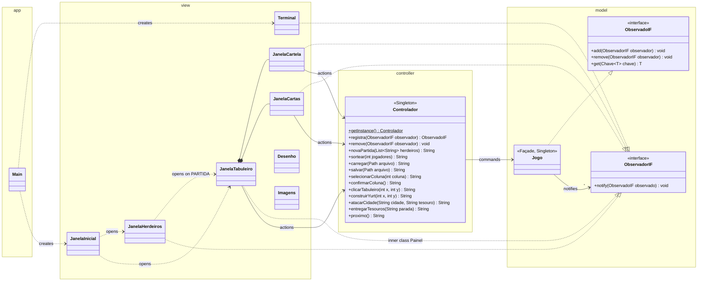
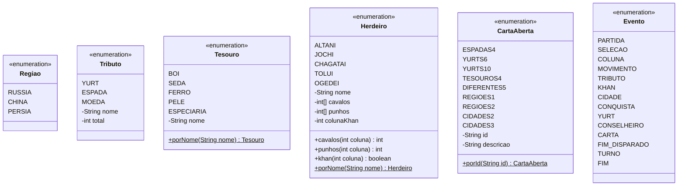

# Diagrama de classes

This diagram shows the code after iteration 3. It follows the rules in [rules.md](rules.md). Section numbers such as "§8.1" point to that file.

The code uses MVC with 4 packages:

- `model`: the game. `Jogo` is the only `public` class, together with the Observer interfaces `ObservadoIF` and `ObservadorIF`. All other model classes are package-private.
- `view`: the windows (Swing and Java2D), the drawing helpers and the terminal output.
- `controller`: `Controlador`. It receives the actions of the windows and calls `Jogo`.
- `app`: `Main`. It starts the terminal observer and the first window.

## Status after iteration 3

| Part | In the code now | Later (iteration 4) |
|---|---|---|
| Turn | Columns with horses, fists and the Khan (§7). Blocked columns until the white column is activated. Moves, with jumps over your own yurts. | Activation pieces as objects. Upgrades on the columns. |
| Tributes and the Khan | 12 provinces, 4 Khan places, the limited supply, "take tribute" and "move the Khan" (§7.2, §7.3). | |
| Cities | City tiles, treasures, attack with swords, conquest (§8.1). | |
| Yurts | Build yurts, 12 for each player, count by region (§8.2). | |
| Kurultai | 7 counselors, deliveries, open counselor cards, votes, end of the game (§8.4 to §8.6, §14). | Bonus pieces, secret cards, influence in the regions, tie-break. |
| Heirs | Horses, fists and the Khan column of each heir. | Heir abilities. Altani's second pawn. |
| Save and load | The players, the turn, the coins, the positions and the blocked columns. | Swords, yurts, treasures, votes, cities, provinces, the Khan and the cards. Now these restart when a game is loaded. |

## Packages and the Observer

The model tells the views about each change with the Observer pattern of chapter 17. The view has no access to the model: it reads the game only with `get`.



How the Observer works:

1. A view calls `Controlador.registra(this)`. The controller adds the view to `Jogo` and returns `Jogo` typed only as `ObservadoIF`, as `Ctrl.registra` in chapter 17.
2. The view reads the fixed data (the map, the heirs, the counselors) one time. Then it calls its own `notify` one time, to get the current state.
3. After each change, `Jogo` calls `notify(this)` on all observers. In `notify`, the view reads with `get` all the values that it draws, keeps them in fields, and repaints. `paintComponent` uses only these fields.
4. The actions of the view go to the controller. Each action returns `null` or the error message. The view shows the error itself, because an error does not change the game.

The contract of the view is in the comment of `ObservadoIF.java`. From the `model` package, a view imports only `ObservadoIF` and `ObservadorIF`. This command must print nothing:

```bash
grep -rnE "import model\.[A-Za-z*]+;" src/main/java/view | grep -vE "ObservadoIF|ObservadorIF"
```

### Keys and events

`get` takes a typed key: `<T> T get(Chave<T> chave)`. For example, `get(NOMES)` returns `List<String>`, so the view needs no cast, and a wrong key is a compile error. The class `Chave<T>` and the 59 keys are nested in `ObservadoIF`, in 7 groups:

| Group | Contents | Examples |
|---|---|---|
| 1. Fixed data | The map, the heirs, the treasure types, the counselors. The view reads them one time. | `PONTOS_PARADAS`, `TIPOS_PROVINCIAS`, `PEDIDOS_CONSELHEIROS` |
| 2. Game data | Values that change only when a game starts. | `NOMES`, `LIMITE_VOTOS`, `CARTAS_ABERTAS` |
| 3. Players | Lists with the player as the index. | `MOEDAS`, `TESOUROS`, `POSICOES`, `COLUNAS_BLOQUEADAS` |
| 4. Turn | The state of the turn of the current player. | `COLUNA_ATIVADA`, `MOVIMENTOS`, `DESTINOS` |
| 5. Board | Yurts, cities, provinces, the Khan and the supply. | `YURTS_NAS_PARADAS`, `TESOUROS_CIDADES`, `POSICAO_KHAN` |
| 6. Kurultai | Votes and the end of the game. | `VOTOS_NO_CONSELHO`, `FIM_DISPARADO`, `VENCEDORES` |
| 7. Event | The kind of the last change and its details. | `EVENTO`, `AUTOR_DO_EVENTO`, `ULTIMA_CIDADE` |

The values are plain Java types (`String`, `Integer`, `Boolean`, `List`, `Map`, `int[]`), never model classes. Each call to `get` returns a new read-only copy.

`get(EVENTO)` returns a value of the nested `enum Evento`. In one action, the order of the events is: the event of the action, then `CONQUISTA`, then one `CARTA` for each card, then `FIM_DISPARADO`.

## Model classes

`Jogo` is a Façade (chapter 17). It keeps what belongs to the game as a whole: the players, the turn, the checks of whose turn it is, and the events. It sends each rule to a smaller class: `Movimento`, `Tributos`, `Cidades`, `Yurts` or `Kurultai`.

```mermaid
classDiagram
    direction LR

    class Jogo {
        <<public>>
        -Jogo instancia$
        -Random aleatorio
        -Mapa mapa
        -Tributos tributos
        -Cidades cidades
        -Yurts yurts
        -Kurultai kurultai
        -List~ObservadorIF~ observadores
        -List~Jogador~ jogadores
        -int jogadorAtual
        -Turno turno
        -int selecionada
        -Evento ultimoEvento
        -int autorDoEvento
        +getInstance()$ Jogo
        +novaPartida(List~String~ herdeiros) void
        +sortear(int n) void
        +selecionarColuna(int jogador, int coluna) void
        +confirmarColuna(int jogador) void
        +ativarColuna(int jogador, int coluna) void
        +mover(int jogador, String paradaId) void
        +pegarTributo(int jogador, String provinciaId) void
        +moverKhan(int jogador, int local) void
        +atacarCidade(int jogador, String cidade, String tesouro) void
        +construirYurt(int jogador, String paradaId) void
        +entregarTesouros(int jogador, String paradaId) void
        +encerrarTurno(int jogador) void
        +paradaEm(int x, int y) String
        +provinciaEm(int x, int y) String
        +localKhanEm(int x, int y) int
        +salvar(Path arquivo) void
        +carregar(Path arquivo)$ Jogo
        +add(ObservadorIF observador) void
        +remove(ObservadorIF observador) void
        +get(Chave~T~ chave) T
        -notificar(Evento evento, int autor) void
    }

    class Turno {
        -Jogador jogador
        -int coluna
        -int movimentos
        -int punhos
        -boolean khan
        -List~Parada~ visitadas
        -Map~Cidade,Integer~ ataques
        ~andar(Parada p) void
        ~usarPunho() void
        ~moverKhan() void
        ~registrarAtaque(Cidade c) void
    }

    class Jogador {
        -Herdeiro herdeiro
        -int moedas
        -int espadas
        -int yurts
        -EnumMap~Tesouro,Integer~ tesouros
        -int votos
        -Parada posicao
        -int bloqueadas
        ~ganhar(Tributo t) void
        ~gastar(Tributo t, int n) void
        ~ganharTesouro(Tesouro t) void
        ~gastarTesouro(Tesouro t) void
        ~ganharVotos(int n) void
        ~bloquear(int coluna) void
        ~liberarColunas() void
    }

    class Mapa {
        -Map~String,Parada~ paradas
        -List~Cidade~ cidades
        -Map~String,Provincia~ provincias
        -List~LocalKhan~ locaisKhan
        -List~Conselheiro~ conselheiros
        ~distancia(Parada a, Parada b) int
        ~paradaEm(int x, int y) Parada
        ~provinciaEm(int x, int y) Provincia
        ~localKhanEm(int x, int y) int
    }

    class Parada {
        -String id
        -Regiao regiao
        -int[] pontos
        -int raio
        -List~Parada~ vizinhas
        -List~Jogador~ yurts
        ~isDupla() boolean
        ~getCapacidadeYurts() int
        ~contem(int x, int y) boolean
    }

    class Provincia {
        -String id
        -Tributo tipo
        -int x
        -int y
        -List~Parada~ adjacentes
        -int pecas
        ~receber() boolean
        ~retirar() void
    }

    class LocalKhan {
        -int x
        -int y
        -List~Provincia~ provincias
        ~contem(int x, int y) boolean
    }

    class Cidade {
        -String nome
        -Regiao regiao
        -int x
        -int y
        -List~Parada~ adjacentes
        -List~Tesouro~ tesouros
        -boolean revelada
        -Jogador dono
        ~revelar(List~Tesouro~ novos) void
        ~retirar(Tesouro t) void
        ~conquistar(Jogador j) void
    }

    class Conselheiro {
        -Parada parada
        -int pedido
        -List~Tesouro~ tipos
        -int votos
    }

    class Movimento {
        <<static>>
        ~alcance(Jogador j)$ Set~Parada~
        ~lotada(Parada p, Jogador quem, List~Jogador~ jogadores)$ boolean
        ~destinos(Turno turno, List~Jogador~ jogadores)$ List~Parada~
    }

    class Tributos {
        -int khan
        ~estoque(Tributo t, List~Jogador~ jogadores) int
        ~pegar(Jogador j, Turno turno, Provincia p) void
        ~moverKhan(Jogador j, Turno turno, int local, List~Jogador~ jogadores) void
        ~alcancaveis(Turno turno) List~Provincia~
    }

    class Cidades {
        -List~Cidade~ pilha
        -List~Tesouro~ saco
        ~sortear(Random aleatorio) void
        ~atacar(Jogador j, Turno turno, Cidade c, Tesouro t) boolean
        ~atacaveis(Turno turno) List~Cidade~
        ~todasConquistadas() boolean
    }

    class Yurts {
        ~construir(Jogador j, Turno turno, Parada p) void
        ~restantes(Jogador j) int
        ~paradasParaYurt(Turno turno) List~Parada~
        ~noMapa(Jogador j, Regiao regiao) int
    }

    class Kurultai {
        -List~CartaAberta~ cartas
        -Map~CartaAberta,Jogador~ donosCartas
        -boolean fimDisparado
        -int turnosRestantes
        -boolean terminada
        ~entregar(Jogador j, Turno turno, Conselheiro c, int atual) void
        ~verificarCartas(int atual) List~CartaAberta~
        ~verificarFim(int atual) void
        ~encerrarTurno() boolean
        ~vencedores() List~Integer~
    }

    Jogo "1" *-- "2..5" Jogador
    Jogo "1" *-- "0..1" Turno
    Jogo "1" *-- "1" Mapa
    Jogo "1" *-- "1" Tributos
    Jogo "1" *-- "1" Cidades
    Jogo "1" *-- "1" Yurts
    Jogo "1" *-- "1" Kurultai
    Jogo ..> Movimento
    Tributos --> Mapa
    Cidades --> Mapa
    Yurts --> Mapa
    Kurultai --> Yurts
    Kurultai --> Cidades
    Turno --> Jogador
    Turno --> "*" Parada : visitadas
    Jogador --> Parada : posicao
    Mapa "1" *-- "34" Parada
    Mapa "1" *-- "12" Provincia
    Mapa "1" *-- "4" LocalKhan
    Mapa "1" *-- "9" Cidade
    Mapa "1" *-- "7" Conselheiro
    Parada --> "*" Parada : vizinhas
    Parada --> "*" Jogador : yurts
    Provincia --> "*" Parada : adjacentes
    LocalKhan --> "3" Provincia
    Cidade --> "3" Parada : adjacentes
    Cidade --> "0..1" Jogador : dono
    Conselheiro --> Parada
```



## Enums

The rules give a fixed list of each of these things, so each one is an `enum`.



`Evento` is nested in `ObservadoIF`. All other enums are package-private in `model`.

## Design decisions

### MVC and the Observer

- The view has no access to the model. It reads the game only with `get`, and it imports only `ObservadoIF` and `ObservadorIF` from `model`. `Jogo` is `public` only because the controller is in another package.
- The keys are typed constants (`Chave<T>`) and the events are an `enum`. Chapter 17 uses `int` for both. With `int`, a key and an event can have the same number, and a mix-up compiles.
- The terminal is an observer (`Terminal`). The controller writes only the errors and the messages of save and load, because these do not change the game.
- `JogoTest` also reads the game only with `get`. `Jogo` has no public getters.
- The group does not use `java.util.Observer` (deprecated since Java 9) or `java.beans.PropertyChangeSupport` (it puts a dependency on the GUI module in the model).

### Façade and smaller classes

`Jogo` checks whose turn it is and sends the rule to one class:

- `Movimento`: where the pawn can go with 1 move (§7.1). It has only static methods.
- `Tributos`: the provinces, the supply and the Khan (§7.2, §7.3).
- `Cidades`: the pile of city tiles, the bag of treasures, the attack and the conquest (§8.1).
- `Yurts`: build yurts, and count them by player and by region (§8.2).
- `Kurultai`: the counselors, the open counselor cards, the votes and the end of the game (§8.4 to §8.6, §14).

### Map: a graph with adjacency lists

- The map is a graph. Each `Parada` is a node, and each route is an edge in the list `vizinhas`. There is no graph library. Adjacency lists are enough for a map of this size.
- A double stop is one `Parada` with two medallions in `pontos`. Thus, going through it costs 1 move (§7.1), and it holds 2 yurts.
- Karakorum is a `Parada` with `regiao = null`. It holds all pawns and no yurts.
- `Mapa` keeps the objects in maps and lists in the order of the board. The GUI and the tests use the ids.
- `distancia` is a breadth-first search on the graph.

The map data is in the constructor of `Mapa`, in Java code. The rulebook shows the map only as a picture, so the group copied the data from the photo of the main board (`src/main/resources/imagens/tabuleiro.jpg`, 2905 x 2919 pixels).

- 34 stops: 11 in each region and Karakorum. The ids are `r1` to `r11` (Russia), `p1` to `p11` (Persia), `c1` to `c11` (China) and `karakorum`.
- 54 routes.
- 9 cities, each with the 3 stops around it.
- 12 provinces, `t1` to `t12`, each with its tribute type and the stops on its border.
- 4 Khan places, each with the 3 provinces that get tribute.
- 7 counselors: the 6 double stops and Karakorum.
- The positions are pixels of the photo. The GUI changes a click to these pixels, and the controller calls `paradaEm`, `provinciaEm` or `localKhanEm`.
- Run the game with `-Dmapa.debug=true` to draw the stops, the routes, the provinces and the Khan places over the board.

### Game pieces: counters, not objects

- Tribute pieces are interchangeable, so `Jogador` has an `int` for each type and `Provincia.pecas` is an `int`. Each province has one printed tribute type.
- The supply is not stored. `Tributos.estoque` calculates it: `Tributo.total` minus the pieces in the provinces and the pieces of the players.
- Treasures are an `EnumMap<Tesouro, Integer>` in `Jogador`, and lists of `Tesouro` in `Cidade` and in the bag of `Cidades`.
- Yurts on the map are references to the owner (`Parada.yurts`). A conquered city has an owner (`Cidade.dono`), and that owner uses 1 of their 12 yurts for it.

### Turn state in `Turno`

Many rules depend on what happened in the current turn. `Jogo` makes a new `Turno` in `ativarColuna` and removes it in `encerrarTurno`.

- `movimentos`, `punhos` and `khan` come from the activated column (§7).
- `visitadas`: "take tribute" (§7.2), "attack a city" (§8.1), "build yurts" (§8.2) and "give treasures" (§8.4) check this list. A stop skipped with a yurt is not in the list.
- `ataques`: the first treasure of a city in a turn costs 1 sword. The next treasures of the same city cost 2 (§8.1).
- `encerrarTurno` fails if the column has the Khan and the player did not move it (§7.3).

### Heirs and columns

`Herdeiro` is an enum with the horses and fists of the red, green and yellow columns, and the column that moves the Khan. The white column (`Herdeiro.BRANCA`) is the same for all heirs: 2 horses, the Khan, and it releases the other columns. A used column stays blocked until the player activates the white column. `Jogador.bloqueadas` is a bit mask of the blocked columns.

### End of the game

- Each vote moves the token of the player and the neutral token (§8.6). The neutral token is the sum of the votes of all players.
- The end starts when the neutral token reaches the limit (10, 14, 16 or 17 votes for 2, 3, 4 or 5 players), or when all cities are conquered (§14). The current round ends, and each player plays one more turn. `Kurultai.turnosRestantes` counts these turns.
- The winners are the players with the most votes. The influence in the regions, the secret cards and the tie-break are for iteration 4.

## Items to confirm with the group

- The abilities of the heirs (`Herdeiro`), for iteration 4.
- Where the delivered treasures go. Now they leave the game (`Jogador.gastarTesouro`).
- The positions of the coin and sword icons in the upgrade area, for iteration 4.
- The save file does not have the state of iteration 3 (see the status table).
