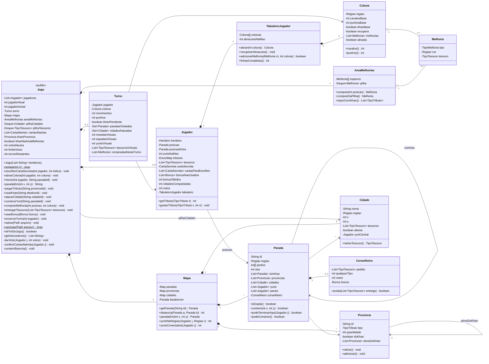
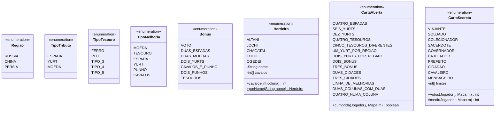

# Diagrama de classes

This diagram follows the rules in [rules.md](rules.md). Section numbers such as "§8.1" point to that file.

All classes are in the `model` package. `Jogo` is the only `public` class. The other classes are package-private. The GUI and the tests call only `Jogo`, and they send ids (`String`) and indexes (`int`), not model objects.

## Status after iteration 2

The diagram shows the full design. The code has only part of it.

| Class | In the code now | Later |
|---|---|---|
| `Jogo` | Constructor, `sortear`, `ativarColuna`, `mover`, `encerrarTurno`, `paradaEm`, `salvar`, `carregar`, and the getters that the GUI uses (`getPosicao`, `getMovimentos`, `getPontos`, `getVizinhas` and others). | All other fields and methods. |
| `Turno` | `jogador`, `movimentos`, and the column as an `int` (0 to 3). | `Coluna` object and all other fields. |
| `Jogador` | `herdeiro`, `posicao`, and `moedas` as an `int`. | `tributos` (it replaces `moedas`) and all other fields. |
| `Herdeiro` | All constants, `nome`, `cavalos`, `porNome`. | Heir abilities. |
| `Mapa`, `Parada` | Stops, routes, coordinates, `distancia`, `paradaEm`, `contem`. | Provinces, yurts, counselors. |
| `Cidade` | `nome`, `regiao`, `x`, `y`. | Treasures and conquest. |
| `Regiao` | All constants. | |
| Other classes and enums | | All. |

The GUI is in the `view` package: `JanelaInicial`, `JanelaHerdeiros`, `JanelaTabuleiro` and `Imagens`. It calls only `Jogo` and draws each game image with `Graphics2D.drawImage`.

## Classes

## Enums

The rules give a fixed list of each of these things, so each one is an `enum`. The cards and the heirs have different rules, so each constant overrides one method.

## Design decisions

### Map: a graph with adjacency lists

- The map is a graph. Each `Parada` is a node, and each route is an edge in the list `vizinhas`.
- A double stop is one `Parada` with two medallions in `pontos`. Thus, going through it costs 1 move (§7.1).
- Karakorum is a `Parada` with `regiao = null`. It holds all pawns and no yurts.
- Each `Parada` also keeps lists of its adjacent `Provincia` and `Cidade` objects. The game uses them for "take tribute" (§7.2), "attack a city" (§8.1), and the secret cards Prefeito, Cidadão, and Bajulador.
- `Mapa` keeps each kind of object in a `Map<String, T>`, with the id as the key. The GUI and the tests use these ids.
- `distancia` and `yurtsConectados` are breadth-first searches on the graph. `distancia` gives the cost of a move (§7.1), the tie-break rule (§14.3) and the Viajante card.
- There is no graph library. Adjacency lists are enough for a map of this size.

The map data is in the constructor of `Mapa`, in Java code. The rulebook shows the map only as a picture, so the group copied the data from the photo of the main board (`src/main/resources/imagens/tabuleiro.jpg`, 2905 x 2919 pixels).

- 34 stops: 11 in each region and Karakorum. The ids are `r1` to `r11` (Russia), `p1` to `p11` (Persia), `c1` to `c11` (China) and `karakorum`.
- 54 routes.
- `pontos` has the center of each medallion in pixels of the photo. `raio` is the click area: 60 for a medallion, 220 for Karakorum. The GUI converts a click to these pixels and calls `Jogo.paradaEm`.
- The 9 cities have a name and a position. Provinces are not in the map yet.
- Run the game with `-Dmapa.debug=true` to draw the stops and the routes over the board.

### Game pieces: counters, not objects

- Tribute pieces are interchangeable, so `Jogador.tributos` is an `EnumMap<TipoTributo, Integer>`. `Provincia.quantidade` is an `int`, because each province has one printed tribute type.
- Treasures are lists of `TipoTesouro`, because the deliveries need the type of each treasure.
- Yurts on the map are references to the owner (`Parada.yurts`, `Cidade.yurtCentral`). `Jogador.yurtsNaMao` counts the yurts that the player did not build.

### Turn state in `Turno`

Many rules depend on what happened in the current turn. `Jogo` makes a new `Turno` in `ativarColuna`. It removes the `Turno` in `encerrarTurno`.

- `paradasVisitadas`: "take tribute" (§7.2), "attack a city" (§8.1), and "build yurts" (§8.2) check this set. A stop skipped with a yurt is not in the set.
- `cidadesAtacadas`: the first treasure costs 1 sword. The next treasures from the same city cost 2 (§8.1).
- `moedasVirtuais`, `espadasVirtuais`, `yurtsVirtuais`, `tesourosVirtuais`: the upgrades of the activated column give these for this turn only (§9).
- `compradasNesteTurno`: an upgrade does not work in the turn that you buy it (§8.3).
- `khanPendente`: `encerrarTurno` fails if the column has a Khan and the player did not use it (§7.3).

### Heirs: one `enum`, checks in the rules

`Herdeiro` is an enum. Each rule method in `Jogo` or `Parada` checks the heir where the ability changes the rule. For example, `construirYurt` accepts an adjacent stop for `TOLUI`. There are 5 heirs, and each one changes one or two rules. Thus, one class for each heir is not necessary.

`Jogador.posicaoExtra` is the second pawn of Altani. It is `null` for all other heirs.

### End of the game

- `darVoto` moves the player token and the neutral token (§8.6). When `votosNeutra` reaches `limiteVotos` (10, 14, 16, or 17), `Jogo` sets `turnosRestantes` (§14).
- `contarInfluencia` uses the table in §14.1. It reads `Mapa.yurtsNaRegiao` and the number of upgrades in the `Coluna` of each region. The white column has `regiao = null`, so it never counts.
- `CartaSecreta.votos` compares the value from `medir` with the 3 numbers in `limites` (§13). For example, `SOLDADO` has `limites = {4, 7, 10}`.

## Items to confirm with the group

These items come from the **[unclear]** marks in `rules.md`. Each one can change the diagram.

- The names of treasure types 3 to 5 (`TipoTesouro`).
- The base actions and the region color of each column (`Coluna` fields). The number of horses of each column is known: `Herdeiro.cavalos` has it for each heir.
- The full ability of each heir (`Herdeiro`).
- Where delivered treasures go. This diagram assumes that `entregarTesouros` puts them back in `pilhaTesouros`.
- The positions of the coin and sword icons in the upgrade area (`AreaMelhorias.reporComKhan`).
