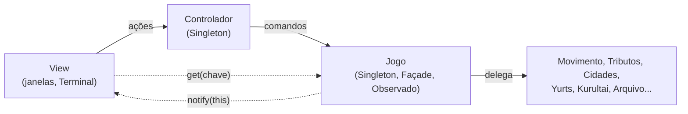

# Padrões de projeto

O jogo usa a arquitetura **MVC** com três padrões do cap. 17: **Singleton**, **Façade** e **Observer**.



## Singleton

Há uma só partida e um só controlador. As duas classes têm construtor privado e um `getInstance()` que cria a
instância na primeira chamada:

- `model.Jogo` (`Jogo.getInstance()`)
- `controller.Controlador` (`Controlador.getInstance()`)

```java
private static Jogo instancia = null;

private Jogo() {
}

public static Jogo getInstance() {
    if (instancia == null) instancia = new Jogo();
    return instancia;
}
```

`novaPartida`, `sortear` e `carregar` não criam um `Jogo` novo. Eles trocam o estado da mesma instância, e por
isso os observadores já inscritos continuam recebendo os avisos.

A criação não é sincronizada. Isso funciona porque o Swing chama tudo na mesma thread (a EDT), a partir de
`app.Main`.

## Façade

`model.Jogo` é a **única classe pública** do pacote `model`, além das interfaces do Observer. As outras classes
(`Mapa`, `Movimento`, `Tributos`, `Cidades`, `Yurts`, `Kurultai`, `Melhorias`, `PecasBonus`, `CartasSecretas`,
`Pontuacao`, `Habilidades`, `Arquivo`...) são package-private.

O controlador chama um só método do `Jogo` (por exemplo, `mover`, `atacarCidade` ou `encerrarTurno`). O `Jogo`
confere se é a vez do jogador e passa o pedido para a classe responsável. Assim, quem está fora do Model não
precisa saber como o Model é dividido por dentro.

O `Controlador` faz o mesmo para a View. Ele recebe os cliques, chama o `Jogo` e transforma as exceções numa
mensagem curta (ou `null` quando a ação dá certo) que a janela pode mostrar.

## Observer

| Papel              | Onde                                                                    |
|--------------------|-------------------------------------------------------------------------|
| Interface observado | `model.ObservadoIF`: `add`, `remove`, `get(chave)`                     |
| Interface observador | `model.ObservadorIF`: `notify(ObservadoIF)`                           |
| Observado concreto | `model.Jogo`                                                            |
| Observadores       | `view.Terminal`, `JanelaHerdeiros`, `JanelaCartela`, `JanelaCartas`, `JanelaSecretas`, `JanelaResultado` |

Como funciona:

1. A View se inscreve pelo controlador: `Controlador.registra(this)` chama `jogo.add(...)` e devolve o `Jogo`
   tipado só como `ObservadoIF`.
2. Toda mudança de estado no `Jogo` chama `notificar(evento, autor)`. Esse método guarda o evento e chama
   `notify(this)` em cada observador.
3. No `notify`, o observador lê o que precisa com `get(chave)` (por exemplo, `get(EVENTO)` ou `get(JOGADOR_ATUAL)`)
   e se redesenha.

Detalhes deste projeto:

- **Chaves tipadas.** No cap. 17, `get` recebe e devolve `int`. Aqui cada chave é uma constante `Chave<T>`, e
  `get(HERDEIROS)` devolve `List<String>` sem conversão. Usar a chave errada é erro de compilação.
- **Só leitura.** `get` devolve tipos comuns do Java (`String`, `List`, `Map`, `int[]`...) em cópias que não podem
  ser alteradas, nunca classes do Model.
- **Evento.** `get(EVENTO)` diz o que mudou (`MOVIMENTO`, `CONQUISTA`, `TURNO`, `FIM`...). Cada janela usa o
  evento para decidir se abre, fecha ou só se redesenha.
- **Lista copiada.** `notificar` percorre uma cópia da lista de observadores. Assim, um observador pode se remover
  dentro do `notify`, como `JanelaHerdeiros` faz.
- **Contrato da View.** Do pacote `model`, a View importa só `ObservadoIF` e `ObservadorIF`. Este comando confere a
  regra e não pode imprimir nada:

  ```bash
  grep -rnE "import model\.[A-Za-z*]+;" src/main/java/view | grep -vE "ObservadoIF|ObservadorIF"
  ```
